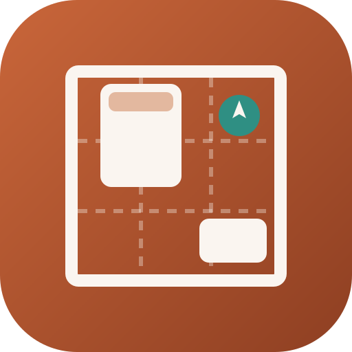

<h1 align="center">
  <br>
  <a href="https://github.com/sudharamachandranrajeev/vinyasa"></a>
  <br>
  Vinyasa
  <br>
</h1>

<h4 align="center">A space organiser for homes, offices and shops: plan a room, see what is wrong with it, and rearrange it step by step.</h4>

<p align="center">
  <a href="https://github.com/sudharamachandranrajeev/vinyasa/releases"></a>
  
  
  
</p>

## Key Features

*Vinyāsa* is Sanskrit for "arrangement, placing with care". Vinyasa checks a room against rules from
ergonomics, accessibility, interior design and Vaastu Shastra, scores it, and finds a better
arrangement you can carry out one step at a time.

* **Spaces and rooms** – a home, an office, a shop or a clinic, each with its rooms. A room has its
  size, which way it faces, its doors and windows, its furniture and who uses it (a wheelchair user,
  older people, young children, left-handed people).
* **Plan** – drag pieces into place, turn and resize them, and lay clearances, walkways from the door
  or the Vaastu grid over the plan.
* **Analysis** – about 45 rules: walkways at least 900 mm, room to open doors and drawers, a bed you
  can get into from both sides, a TV at the right distance, a kitchen work triangle, a balanced room
  with a focal point, and Vaastu's directions as gentle advice or strict rules. Each finding says why it
  matters and what to do, and lights up the pieces on the plan.
* **Plan from photos** – an AI you choose in Ask AI (a free Gemini key, Anthropic, OpenAI,
  OpenRouter, or a vision model on your own computer) draws the room from its photos and videos. Photos
  are made smaller and lose their location and camera details before they are sent; you check every
  piece before it goes on the plan. Gemini reads a short video as it is; for the others frames are taken
  from it, which on a computer needs [FFmpeg](https://ffmpeg.org) installed.
* **Arrange** – Vinyasa tries thousands of arrangements and keeps the one that fixes most for the least
  lifting, moving things that belong together as one. The pieces glide to their new places; keep the
  plan and follow it step by step.
* **Ideas** – twelve looks with their palettes, the tips people rate most, and searches on Pinterest,
  Houzz, Behance, Dribbble and Unsplash for your room and look.
* **Themes** – eight themes made for interiors, your own in the theme editor, light and dark.
* **Updates and going back** – updates install from GitHub releases after their checksums match, with a
  backup first. Settings › Updates goes back to an earlier version.
* **Problem reports** – write what happened; Vinyasa adds the version history, system, theme and
  recent errors you choose, and opens a GitHub issue for you to send.
* **Private** – the database is encrypted, photos stay on the device unless you send them for a plan,
  and sync (through Brahma) is
  end-to-end encrypted to your own server.

## How To Use

1. Open **Spaces** and add a space, or tap **Try an example**.
2. Add a room: its name, use, size and which way the top wall faces.
3. On **Plan**, add furniture, doors and windows and drag them where they are.
4. **Analysis** shows the scores and what to fix. **Arrange** finds a better layout; keep it and tick
   the steps as you move things.

## Download

Releases for Android (APK), Windows (installer or portable zip) and Linux (tarball with `install.sh`)
are on the [releases page](https://github.com/sudharamachandranrajeev/vinyasa/releases).

## Building

```bash
flutter pub get
dart run build_runner build --delete-conflicting-outputs
flutter test
flutter run -d linux
```

## Related

Vinyasa is one of the [Brahma](https://github.com/sudharamachandranrajeev/brahma) apps and shares its
core: sync, app lock, Sentinel and the app shell.

## License

MIT
