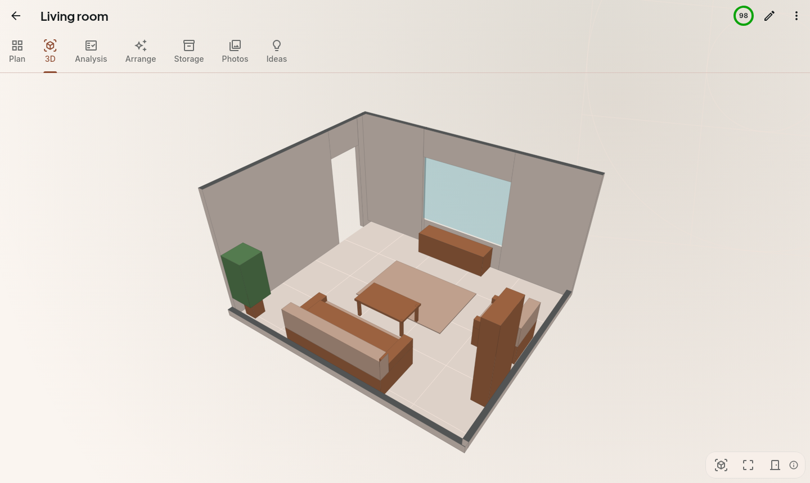
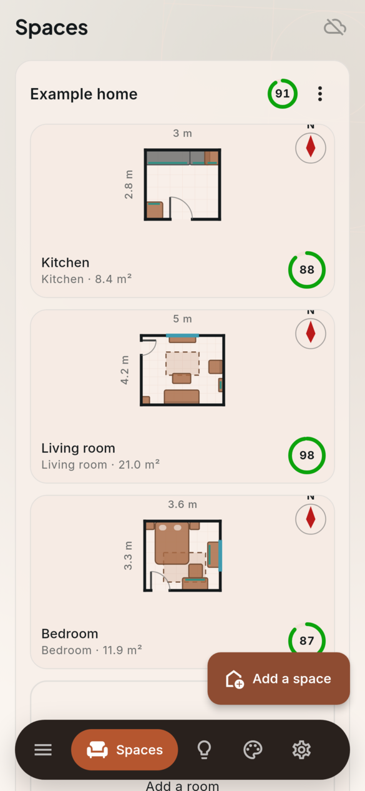
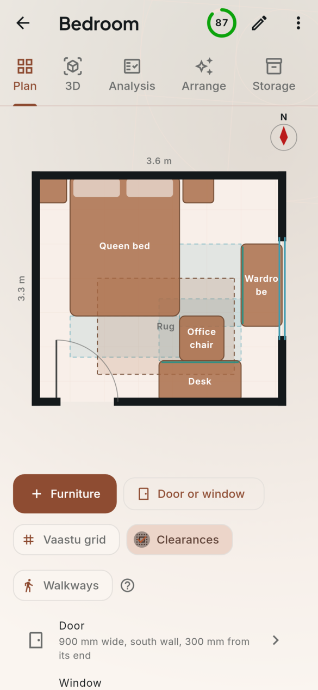
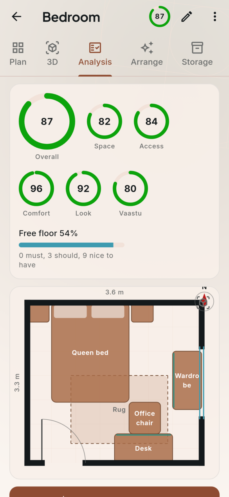
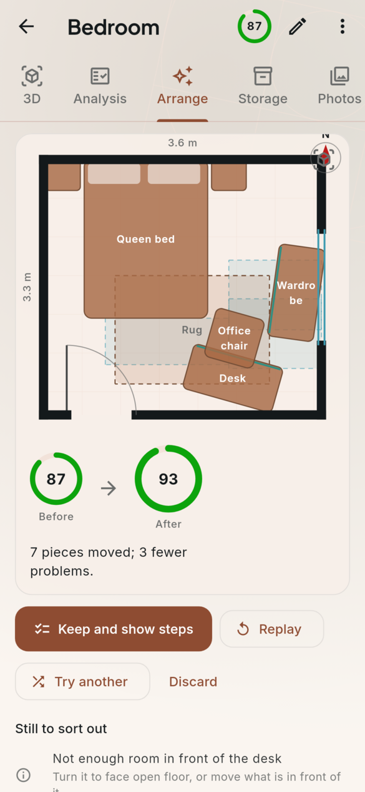
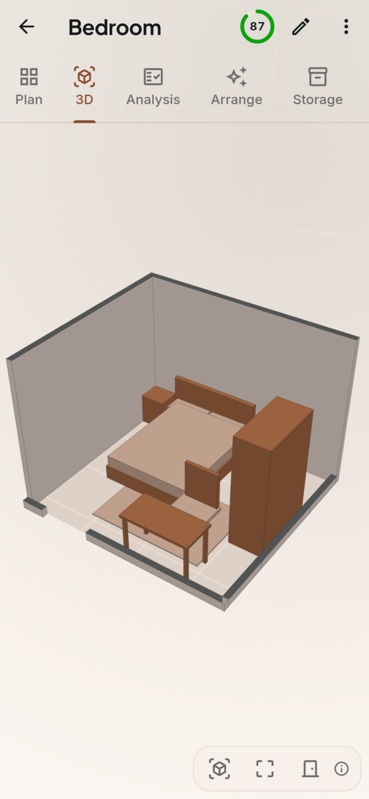
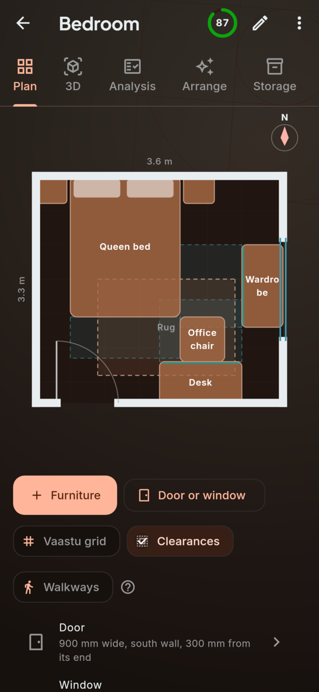
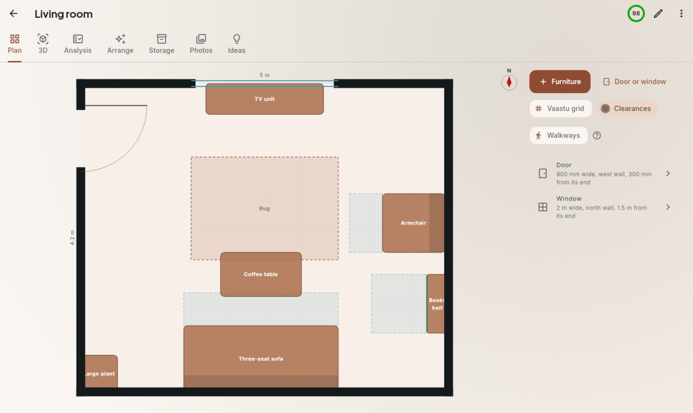
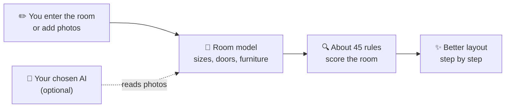

<h1 align="center">
  <br>
  <a href="https://github.com/sudharamachandranrajeev/vinyasa"></a>
  <br>
  Vinyasa
  <br>
</h1>

<h4 align="center">Plan any room, see what is wrong with it, and rearrange it step by step: at home, at work or in a shop.</h4>

<p align="center">
  <a href="https://github.com/sudharamachandranrajeev/vinyasa/releases"></a>
  
  
  <a href="https://github.com/sudharamachandranrajeev/brahma"></a>
</p>

<p align="center">
  <a href="#-what-it-does">What it does</a> •
  <a href="#-get-started">Get started</a> •
  <a href="#-how-it-works">How it works</a> •
  <a href="#-faq-and-troubleshooting">FAQ</a> •
  <a href="#%EF%B8%8F-for-developers">For developers</a>
</p>

<p align="center">
  
</p>

*Vinyāsa* is Sanskrit for "arrangement, placing with care". Vinyasa is for anyone setting up a
room: a bedroom, a kitchen, an office or a shop floor. It checks the room against rules from
ergonomics, accessibility, interior design and Vaastu, then finds a better layout you can follow
one step at a time. Status: **early** (0.2.0, a pre-release). Sizes come from what you enter, so
measure carefully.

## ✨ What it does

- 🏠 **Spaces and rooms** – a home, office, shop, clinic or studio, each with its rooms: size,
  which way it faces, doors, windows, furniture, and who uses it (a wheelchair user, older people,
  young children).
- ✏️ **Draw the plan** – drag about 60 kinds of furniture into place, turn and resize them, and show
  clearances, walkways from the door or the Vaastu grid.
- 🔍 **See what is wrong** – about 45 rules, such as walkways at least 900 mm wide, room to open
  doors and drawers, and a kitchen work triangle. Each finding says why it matters and what to do.
- ✨ **A better arrangement** – Vinyasa tries thousands of layouts and keeps the one that fixes most
  for the least lifting. Keep it and tick off the steps as you move things.
- 🧊 **Walk round it in 3D** – turn, tilt and zoom, or jump to the view from the door. The nearest
  walls lower so you can see in.
- 📐 **Will it fit?** – before you buy, give a piece's size. Vinyasa shows the three best places for
  it and checks it gets through the door.
- 🗄️ **Storage** – list what your wardrobes and shelves hold, and Vinyasa says which shelf each
  thing belongs on, with labels to print. Or photograph the open cupboards and let the AI write the
  list for you.
- 📷 **Plan from photos** (optional) – an AI you choose reads photos or a short video of the room and
  draws it. You check every piece first.
- 💡 **Ideas** – twelve looks with colour palettes, openly licensed photos, and a moodboard per room.

<details>
<summary><b>Everything else</b></summary>

| Feature | Details |
| --- | --- |
| Vaastu | Off, gentle (advice) or strict (weighs more in the score), for each room |
| Scores | Space, access, comfort, look and Vaastu, weighed by what matters in that room |
| Storage methods | Tidy-by-category order at home, 5S at work, ABC slotting in a storeroom |
| Idea searches | Popular design and photo sites, built from the room and look |
| Idea photos | [Openverse](https://openverse.org) (no account) or [Unsplash](https://unsplash.com) (your own free key) |
| AI for photos | Gemini (free key), Anthropic, OpenAI, OpenRouter, or a vision model on your own computer |
| Themes | Eight themes made for interiors, your own in the theme editor, light and dark |
| Updates | From GitHub releases, checked against SHA-256 sums, with a backup first. You can go back a version |
| Problem reports | Opens a GitHub issue with the details you choose to include |
| Crash log | Every error the app could not handle, kept on the device with full details, to read or attach to a report |
| Backup | Every space, room and plan in one file. Sync and app lock come from Brahma |

</details>

## 📸 Screenshots

<table>
  <tr>
    <td align="center"><br><sub>Your spaces</sub></td>
    <td align="center"><br><sub>Plan</sub></td>
    <td align="center"><br><sub>Analysis</sub></td>
  </tr>
  <tr>
    <td align="center"><br><sub>Arrange</sub></td>
    <td align="center"><br><sub>3D view</sub></td>
    <td align="center"><br><sub>Plan (dark)</sub></td>
  </tr>
</table>

<p align="center">
  <br>
  <sub>Plan on a desktop window</sub>
</p>

<sub>All screenshots show the app's built-in example home, rendered from the current code.</sub>

## 🚀 Get started

### Step 1 – Download

Open the [releases page](https://github.com/sudharamachandranrajeev/vinyasa/releases) and, under
the newest release, pick the file for your device:

| Your device | File to download | Works on |
| --- | --- | --- |
| 🐧 Linux computer | `Vinyasa-<version>-linux-x64.tar.gz` | Ubuntu 24.04, Fedora, Arch and similar (64-bit x86) |
| 🪟 Windows computer | `Vinyasa-<version>-windows-x64-setup.exe` | Windows 10 (version 1809) and 11, 64-bit |
| 🤖 Android phone or tablet | `Vinyasa-<version>-android.apk` | Android 7 and newer |

Each release also has `SHA256SUMS.txt`, a list of fingerprints to check the files are genuine.

### Step 2 – Install

<details>
<summary><b>🐧 Linux</b></summary>

1. Open a terminal in the folder where the download landed.
2. Unpack it and run the installer as your normal user (not `sudo`):
   ```sh
   tar -xzf Vinyasa-*-linux-x64.tar.gz
   cd vinyasa-*-linux-x64 && ./install.sh
   ```
3. Open **Vinyasa** from your app menu.

Vinyasa needs GTK 3, libsecret and a running keyring (GNOME Keyring or KWallet), which holds the
key to your data. The installer warns if one is missing. To remove the app later, run
`./install.sh --uninstall` from the same folder; your data stays.

</details>

<details>
<summary><b>🪟 Windows</b></summary>

1. Double-click `Vinyasa-<version>-windows-x64-setup.exe`. No admin rights needed.
2. Windows may say *"Windows protected your PC"*. This appears because the app isn't paid-signed
   yet, not because it is harmful. Click **More info → Run anyway**.
3. Follow the installer, then open **Vinyasa** from the Start menu.

Prefer no installer? Download `…-windows-x64-portable.zip`, unzip it anywhere and run `vinyasa.exe`.

</details>

<details>
<summary><b>🤖 Android</b></summary>

1. Open the downloaded `.apk` on your phone.
2. If Android asks, allow installs from your browser or file manager. This is normal for apps
   from outside an app store.
3. Tap **Install**, then **Open**.

Newer versions install over the top and keep your data.

</details>

### Step 3 – First launch

1. Vinyasa asks where your data should live. Pick **Keep everything on this device** to start.
   You can turn on sync later in **Settings**.
2. On **Spaces**, tap **Try an example** to explore a ready-made home, or **Add a space** for your
   own.
3. In your space, choose **Add a room**: its name, use, size and which way the top wall faces.
4. On the room's **Plan** tab, tap **Furniture** and **Door or window**, then drag each piece to
   where it stands.
5. Open **Analysis** to see the scores and what to fix.
6. Open **Arrange** and tap **Find a better arrangement**. Like it? Tap **Keep and show steps** and
   tick each step as you move things.

### Step 4 (optional) – Plan from photos

1. On the room's **Photos** tab, tap **Add photos or videos**.
2. Tap **Make a plan from these**. The first time, Vinyasa asks you to **Set up Ask AI**: pick a
   provider and paste your own key.
3. Check each piece it found, then tap **Use this plan**.

On a computer, reading a video with any AI other than Gemini needs [FFmpeg](https://ffmpeg.org)
installed.

### Step 5 (optional) – Use it on more than one device

Open **Settings → Sync → Set up sync** and follow the steps. You need a Brahma
sync server, at home or on Cloudflare's free plan;
[Adisthanam](https://github.com/sudharamachandranrajeev/adisthanam) sets one up at home.

## 🧭 How it works



- **Every score and arrangement** is worked out on your device. No account is needed.
- **The AI is optional.** It only turns photos into a room. The rules always run without it.
- **Photos go out only when you ask** for a plan from them. They are made smaller first and lose
  their location and camera details.
- **The rules and their sources** are listed in [Vinyasa's rules](docs/rules.md).

## 🔒 Your data

- **Where it lives**: in an encrypted database on the device. Linux:
  `~/.local/share/dev.brahma.vinyasa`. Windows: under `%APPDATA%`. Android: inside the app.
- **What leaves the device**: update checks on GitHub, idea searches you tap, photo searches on
  Openverse or Unsplash, photos you send for a plan, and sync if you turn it on. Sync is
  end-to-end encrypted (only your devices can read it).
- **Back up**: **Settings → Backup → Save a backup** writes every space, room and plan to one
  file. **Restore** brings it back.
- **Crash log**: errors stay on the device, in the `crashes` folder inside the data folder. Your
  home folder, account name and e-mail addresses are left out. They leave only if you send a problem
  report.
- **Delete**: uninstall the app, then delete the data folder above.

> [!IMPORTANT]
> On Android, uninstalling the app deletes its data. Save a backup, or turn on sync, first.

## ❓ FAQ and troubleshooting

<details>
<summary><b>Do I need an account or the internet?</b></summary>

No. Vinyasa works fully offline on one device. You only need the internet for updates, idea photos,
plans from photos, and sync.
</details>

<details>
<summary><b>Windows says the app might be unsafe</b></summary>

The build isn't code-signed (a paid certificate). Click **More info → Run anyway**. Check the file
against `SHA256SUMS.txt` on the release if you want to be sure it is genuine.
</details>

<details>
<summary><b>Linux: Vinyasa does not start, or talks about a keyring</b></summary>

The key that unlocks your data lives in the desktop keyring. Install libsecret and GNOME Keyring
(or KWallet), make sure the keyring is running and unlocked, then start Vinyasa again.
</details>

<details>
<summary><b>Does Plan from photos cost money?</b></summary>

It uses your own key, so any cost is billed by that provider. A Gemini key is free, and a vision
model on your own computer costs nothing.
</details>

<details>
<summary><b>Is Vaastu forced on me?</b></summary>

No. For each room, Vaastu is gentle advice by default. Turn it off, or make it strict if it
matters to you, when you edit the room.
</details>

<details>
<summary><b>How do I go back to an older version?</b></summary>

1. Open **Settings → Updates → Go back to an earlier version** and pick one.
2. On Linux and Windows, Vinyasa backs up your data and installs it in place. That version is not
   offered again when the app starts; a newer one is.
3. On Android, the phone will not install an older version over a newer one. Vinyasa saves your
   data to a file you choose and opens the release page. Uninstall Vinyasa, install the older APK,
   then use **Settings → Backup → Restore** with that file.
</details>

<details>
<summary><b>Vinyasa crashed. How do I report it?</b></summary>

1. Start Vinyasa again. It tells you it met an error last time; tap **See**. (Or open
   **Settings → Crash log**.)
2. Tap **Report a problem with it**. The newest crash details are already ticked.
3. Say what you were doing, read the whole report, then choose **Open on GitHub**, **Copy** or
   **Save**. Nothing is sent until you submit it on GitHub.
</details>

## 🛠️ For developers

<details>
<summary>Build from source, test and release</summary>

You need [Git](https://git-scm.com) and [Flutter](https://flutter.dev) 3.47.

```bash
git clone https://github.com/sudharamachandranrajeev/vinyasa
cd vinyasa
flutter pub get
dart run build_runner build --delete-conflicting-outputs
flutter run -d linux        # or windows, or an Android device

flutter analyze && flutter test                                           # check and test
VINYASA_SHOTS=/tmp/vinyasa-shots flutter test test/screenshots_test.dart  # render the screenshots
scripts/make-icons.sh                                                     # app icons from branding/vinyasa.svg
```

- CI runs everything on each push. A `v*` tag builds, smoke-tests and publishes the Android,
  Windows and Linux builds (`.github/workflows/release.yml`).
- Every rule's numbers and sources: [docs/rules.md](docs/rules.md). Changes per version:
  [CHANGELOG.md](CHANGELOG.md).

</details>

<details>
<summary>Credits</summary>

- [Flutter](https://flutter.dev), [Riverpod](https://riverpod.dev) and [drift](https://drift.simonbinder.eu)
  over [SQLite3MultipleCiphers](https://utelle.github.io/SQLite3MultipleCiphers/) for the encrypted
  database
- [Inter](https://rsms.me/inter/) and [Plus Jakarta Sans](https://github.com/tokotype/PlusJakartaSans) fonts
- [Openverse](https://openverse.org) for idea photos
- [FFmpeg](https://ffmpeg.org) for video frames on computers

</details>

## Related

Vinyasa is one app in the **Brahma** family. They share one sign-in and one sync server.

| App | What it does |
| --- | --- |
| [brahma](https://github.com/sudharamachandranrajeev/brahma) | The shared core and the all-in-one app |
| [adisthanam](https://github.com/sudharamachandranrajeev/adisthanam) | Your own sync server, set up with one command |
| [artha](https://github.com/sudharamachandranrajeev/artha) | Money, accounts and investments |
| [graha-anveshana](https://github.com/sudharamachandranrajeev/graha-anveshana) | Find a home to rent or buy |
| [vidya](https://github.com/sudharamachandranrajeev/vidya) | Learning, flashcards and focus |

## License

[MIT](LICENSE)

---

> GitHub [@sudharamachandranrajeev](https://github.com/sudharamachandranrajeev)
